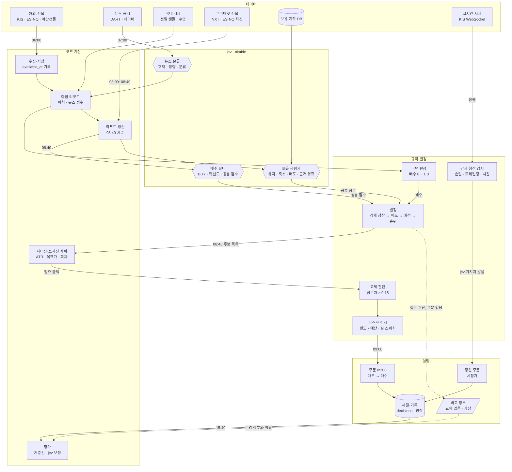

# 운영 전략

- 작성일: 2026-10-10
- 상태: 초안 (검토 중)
- 관계: `plan.md` 3.6 전략과 자동매매를 구체화한 문서. 리스크 규칙(`plan.md` 3.7)은 이 문서의 모든 판단보다 우선한다.
- 용어: `plan.md`와 같다. 운영 시기는 모의 운영 → 실전 운영 → 확장(`plan.md` 1장), 개발 순서는 마일스톤 M0~M7(`plan.md` 7장).

## 0. 워크플로

jev는 판단 세 곳(뉴스 분류, 매수 필터, 보유 재평가)에만 들어간다. 입력은 항상 코드가 만든 리포트이고, 출력은 규칙·결정 열을 거쳐야만 주문이 된다. 강제 청산은 jev를 거치지 않는다. 그림은 시각화 문서의 "운영 전략 워크플로"에도 있다.



## 1. 원칙

1. **숫자는 코드, 판단은 jev, 한도는 규칙.** 지표·목표 주가·수량은 코드가 계산한다. jev는 "살까, 팔까"를 확률로 답하는 데만 쓴다. 어떤 판단도 리스크 한도를 넘을 수 없다.
2. **금액이 아니라 위험으로 정한다.** 모든 예산과 수량은 "손절선에 닿았을 때 잃는 금액"을 기준으로 계산한다.
3. **모델은 위험을 줄이는 쪽으로만 규칙을 앞설 수 있다.** jev는 매도를 앞당길 수 있지만 손절을 미룰 수 없다. 계획에 없는 추가 매수도 할 수 없다.
4. **기본값은 "안 함"이다.** 데이터가 늦거나, Ollama가 응답하지 않거나, 대사가 어긋나 있으면 그날 신규 매수를 하지 않는다. 강제 청산은 그래도 실행한다.
5. **모든 판단을 기록하고 기준선과 비교한다.** jev가 단순 규칙보다 낫다는 것이 모의 운용으로 확인될 때만 jev를 쓴다.

## 2. 대상 종목

- 기본: **KOSPI200 구성 종목** (파라미터로 "시가총액 상위 N개"로 바꿀 수 있음)
- 제외: 거래정지, 관리종목, 투자경고 이상, 최근 20일 평균 거래대금이 하한 미만인 종목
- 대형주로 좁히는 이유: 유동성이 커서 모의 체결이 실전과 덜 다르고, NXT 거래 대상이며, 뉴스가 많아 판단 재료가 충분하다.

## 3. 하루 일정

| 한국 시간 (서머타임 중 / 해제 후) | 이벤트 | 작업 |
|---|---|---|
| 05:00 / 06:00 | 미국 정규장 마감 | |
| 06:00 | KOSPI200 야간선물 마감 (05:00 자료도 있어 확인 필요) | 해외·선물 데이터 수집 |
| 07:00 | | **아침 리포트 생성** (4장), 뉴스 평가 (5장), 시장 국면 판정 (7장) |
| 08:00 ~ 08:50 | NXT 프리마켓 | 프리마켓 시세를 리포트에 추가 (정보로만. 모의투자는 시간외 주문 불가) |
| 08:40 | | 미국 지수 선물(ES·NQ) 최신값으로 리포트 갱신 → **jev 판단** (6장) |
| 08:45 | | **결정**: 강제 청산 → 매도 → 예산 → 사이징 → 리스크 검사 (14장) |
| 09:00 | KRX 개장 | 매도 주문 → 체결 확인 → 매수 주문. 분할매수 회차 실행 |
| 장중 | | **강제 청산 규칙만** 실시간 감시 (11장) |
| 15:30 | KRX 정규장 마감 | |
| 15:40 | | 대사, 일일 평가 기록, 계획 만료 처리 |

미국 서머타임은 2026-11-01에 끝난다. 일정은 시장 캘린더에서 계산하고 하드코딩하지 않는다. 장 시작 동시호가(08:30~09:00)에 주문을 넣을지는 모의투자 지원 여부를 확인한 뒤 정한다.

## 4. 아침 리포트

**리포트의 모든 숫자는 코드가 계산한다.** jev는 읽기만 한다. 모든 값에는 `available_at`(실제로 받을 수 있었던 시각)이 있고, 판단 시점 이전 값만 쓴다.

| 묶음 | 피처 예 |
|---|---|
| 간밤 미국 | S&P 500·나스닥 지수 선물 등락, SOX 구성 종목 등락, 연관 종목(예: 반도체 → NVDA, MU) 등락, EWY 등락 |
| 선물 | KOSPI200 야간선물 종가 대비 전일 정규장 종가 갭 |
| 거시 | 원/달러 변화, 미국 10년물 금리 변화, VIX 수준 |
| 국내 전일 | 등락률, 거래대금 변화, 외국인·기관 순매수, 20/60일 이동평균 대비 위치, RSI, ATR |
| 뉴스 | 종목별 뉴스 점수 (5장) |
| NXT 프리마켓 | 프리마켓 가격의 전일 종가 대비 등락 (대상 종목만) |
| 보유 정보 (보유 종목만) | 보유 일수, 손절선까지 거리(ATR 단위), 매수 당시 판단 기록 |

종목과 미국 연관 종목의 매핑(업종, 공급망)은 사람이 관리하는 설정 파일로 둔다.

## 5. 뉴스 수집과 평가

- 대상: 2장의 종목만.
- 소스 (공식 API만, 크롤링 안 함)

| 소스 | 내용 | 비고 |
|---|---|---|
| DART OpenAPI | 공시 | 공식 데이터. 신뢰도 가장 높음 |
| 네이버 검색 API (뉴스) | 기사 제목·요약·링크 | 하루 호출 한도 있음 (확인 필요) |
| KIS 시황·뉴스 API | 종목 뉴스 | 제공 여부와 범위 확인 필요 |

- 기사마다 jev에 질문한다.

| 질문 | 유형 | 답 |
|---|---|---|
| 이 기사가 해당 종목에 호재인가 | `noul` | 확률 |
| 영향의 크기 | `score` | 작음 / 보통 / 큼 |
| 분류 | `choice` | 실적, 수주, 규제, 소송, 지배구조, 업황, 기타 |

- 종목별 뉴스 점수 = 최근 N시간 기사들의 (호재 확률 − 0.5) × 영향 가중치 합. 같은 사건을 다룬 중복 기사는 제목 유사도로 묶어 한 번만 센다.
- 공시는 기사보다 가중치를 높게 둔다.
- 기사와 평가 결과는 모두 저장한다. 수집 시각이 `available_at`이다.

## 6. jev 판단

- 모델: `nimble` (9B). `tev1`은 실험 표시가 있어 쓰지 않는다. 모델 이름과 해시를 판단마다 기록한다.
- 호출: Ollama `/v1/systemone`. `strategy` 모듈의 `ScreenCandidatesPort`, `ReviewPositionsPort` 뒤에 두고 `adapter/out/llm/ollama`에서 `@HttpExchange`로 구현한다.

### 6.1 질문

| 대상 | 질문 | 유형 | 쓰임 |
|---|---|---|---|
| 후보 종목 | 사야 하는가 | `choice` BUY / SKIP | 1차 필터 |
| 후보·보유 공통 | 향후 N거래일 안에 상승 마감할 가능성 | `noul` | **공통 점수.** 후보와 보유 종목을 같은 잣대로 비교 (교체 매매, 12장) |
| 후보 종목 | 확신도 | `score` 낮음 / 보통 / 높음 | 사이징 가중치 (8장) |
| 보유 종목 | 어떻게 할까 | `choice` HOLD / REDUCE / SELL | 재평가 매도 (11장) |
| 보유 종목 | 매수 근거가 아직 유효한가 | `noul` | 매도 판단, 분할매수 다음 회차 진행 여부 (9장) |

### 6.2 기준값

- 매수: BUY 확률 ≥ 0.70
- 매도: SELL 확률 ≥ 0.60, 또는 "근거 유효" 확률 < 0.40
- 매수와 매도 기준을 일부러 다르게 둔다. 같으면 경계에 걸친 종목이 사고팔기를 반복한다.

### 6.3 지켜야 할 것

- **실패하면 매매하지 않는다.** Ollama가 타임아웃이거나 응답 형식이 틀리면 그날 신규 매수와 jev 매도를 건너뛴다. 강제 청산은 계속 동작한다.
- **응답을 검증한다.** 유니버스에 없는 종목, 정의되지 않은 선택지는 버린다.
- **백테스트에서는 종목명과 날짜를 지운다.** 모델이 학습 때 본 과거 사건을 기억해서 답할 수 있기 때문이다. 리포트에는 익명화한 피처만 넣는다.
- **평가손익은 처음에 넣지 않는다.** 손익을 보면 "손실 종목은 버티고 수익 종목은 일찍 파는" 처분 효과 쪽으로 판단이 기울 수 있다. 넣은 버전과 뺀 버전을 모의에서 비교한다.

## 7. 위험 예산

세 층으로 계산한다.

```
1. 고정 상한 (바뀌지 않음)
   - 하루 신규 위험 합계 ≤ 총자산 × 1.5%
   - 총 노출 ≤ 총자산 × 80%  (최소 현금 20%)

2. 국면 배수 (코드가 07:00에 계산, 0 ~ 1.0)

3. 오늘 쓸 수 있는 신규 위험
   = 고정 상한 × 국면 배수 − 진행 중인 분할매수 계획의 남은 회차 위험
```

| 국면 | 배수 | 판정 (예시, 백테스트로 조정) |
|---|---|---|
| 위험 선호 | 1.0 | KOSPI200 > 200일 이동평균, VIX < 20, 야간선물 갭 ≥ −0.5% |
| 중립 | 0.6 | 위 조건 중 하나 미충족 |
| 위험 회피 | 0.3 | KOSPI200 < 200일 이동평균이면서 VIX ≥ 25 |
| 폭락 | 0 | 야간선물 갭 ≤ −3% 또는 VIX ≥ 35. 신규 매수 없음 |

- 배수는 **줄이는 쪽으로만** 작동한다. 시장이 좋아도 고정 상한을 넘지 않는다.
- 국면은 코드 지표로만 판정한다. 계좌 전체의 위험 크기를 모델에 맡기지 않는다.
- 진행 중인 분할매수의 남은 회차는 예산을 미리 잡아 둔다. 그래야 다음 회차를 살 돈이 없는 상황이 생기지 않는다.

## 8. 사이징

```
계획 위험  = 총자산 × r                            r = 0.5%
계획 수량  = 계획 위험 ÷ (진입가 − 무효화 가격)        무효화 가격 = 진입가 − k × ATR(20),  k = 2
최종 수량  = 계획 수량 × 확신도 가중치                 낮음 0.5 / 보통 0.75 / 높음 1.0
상한       = 종목당 비중 20%, 주문당 100만 원, 오늘 남은 신규 위험(7장)
```

- 변동성이 큰 종목은 적게, 작은 종목은 많이 사게 되어 종목마다 감수하는 위험이 비슷해진다.
- **켈리 공식은 모의 운영에서 쓰지 않는다.** 켈리는 보정된 승률과 손익비가 필요한데, jev 확률은 보정된 값이 아니다. 모의 운용 기록으로 실제 승률·손익비가 쌓이면 하프 켈리 이하로 검토한다.
- 수량은 호가 단위·최소 주문 단위로 내림한다.

## 9. 포지션 계획 (분할매수)

종목 하나를 매수 신호 하나가 아니라 **며칠에 걸쳐 실행되는 계획 하나**로 다룬다.

### 9.1 계획의 구성

| 항목 | 예 | 정하는 때 |
|---|---|---|
| 목표 금액 | 300만 원 (8장 공식) | 계획 생성 시 |
| 회차 | 3회 × 100만 원 | 계획 생성 시 |
| 회차 조건 | 9.2 | 계획 생성 시 |
| 무효화 가격 | 진입가 − 2 ATR | 계획 생성 시. 이후 내리지 않음 |
| 목표 주가 | 10장 | 계획 생성 시 |
| 만료 | 5거래일 | 계획 생성 시 |

**위험은 계획 전체로 계산한다.** 모든 회차가 체결된 상태에서 무효화 가격에 닿았을 때의 손실이 `총자산 × r` 이내가 되도록 목표 금액을 정한다. 물타기 회차가 있어도 최대 손실은 처음 계획한 범위를 넘지 않는다.

### 9.2 회차 방식 (전략 파라미터로 하나를 고름)

| 방식 | 2회차 이후 조건 | 성격 |
|---|---|---|
| 시간 분할 | 직전 회차 + 1거래일, 매수 근거 유효 | 진입 시점 분산 |
| 계획된 물타기 | 1회차 대비 −1 ATR 이하, 매수 근거 유효 | 평균 단가를 낮춤. 틀렸을 때 틀린 쪽에 돈이 더 들어감 |
| 불타기 | 1회차 대비 +1 ATR 이상, 매수 근거 유효 | 맞았다는 확인 뒤 늘림. 추세 전략과 맞음 |

- 모든 회차는 실행 직전에 jev "매수 근거가 아직 유효한가" ≥ 0.5를 다시 확인한다.
- **계획에 없는 추가 매수는 리스크 검사에서 거부한다.** 즉흥적 물타기를 막는 장치다.
- 세 방식을 백테스트와 모의 운용에서 비교한다.

### 9.3 상태

```
PLANNED → ACCUMULATING → HOLDING → EXITING → CLOSED
              │               │
              └───────────────┴→ CANCELLED (무효화 가격 도달, 만료, 근거 소멸, 킬 스위치)
```

- `ACCUMULATING → HOLDING`: 목표 금액을 다 채우면 추가 매수를 멈춘다. 이후로는 매도 규칙(11장)만 적용한다.
- 만료되면 남은 회차를 취소하고, 이미 산 수량으로 `HOLDING`에 들어간다. 무효화 가격은 그대로 둔다.
- `CANCELLED`가 무효화 가격 도달 때문이면 보유분을 전량 손절한다.

## 10. 목표 주가

여러 방법으로 계산해 두고, 전략이 하나를 고르거나 **가장 보수적인 값**(가장 낮은 값)을 쓴다.

| 방법 | 계산 | 데이터 |
|---|---|---|
| 변동성 기준 | 진입가 + m × ATR (m = 4, 손익비 2:1) | 캔들 |
| 기술적 저항 | 최근 60일 고점, 매물대 | 캔들 |
| 밸류에이션 | 과거 PER 밴드 상단 × 예상 EPS | 재무·컨센서스 (소스 확인 필요) |
| 애널리스트 목표가 | 최근 3개월 목표가 평균 | KIS 투자의견 API 제공 여부 확인 필요 |

목표 주가에 닿으면:

1. 보유 수량의 절반을 이익 실현한다.
2. 나머지는 트레일링 스탑으로 따라간다(11장).

처음에는 캔들만으로 계산할 수 있는 변동성 기준과 기술적 저항만 쓴다.

## 11. 매도

### 11.1 두 층

| 층 | 누가 | 언제 | 권한 |
|---|---|---|---|
| **강제 청산** | 코드 | 장중 실시간 | 항상 실행. jev가 막을 수 없음 |
| **재평가 매도** | jev | 매일 08:40 | 강제 청산보다 **앞당길 수만** 있음 |

### 11.2 강제 청산 규칙

| 규칙 | 조건 | 수량 |
|---|---|---|
| 손절 | 가격 ≤ 무효화 가격 | 전량 |
| 트레일링 스탑 | 목표 주가 도달 이후, 가격 ≤ 최고가 − k × ATR | 남은 전량 |
| 시간 청산 | 보유 20거래일 초과 | 전량 |
| 일일 손실 한도 | 계좌 일일 손실이 한도 초과 | 그날 신규 매수 중단. 청산 여부는 설정 |
| 킬 스위치 | 수동 | 전량 + 미체결 취소 |

- 모의투자는 조건부(스탑) 주문을 지원하지 않는 것으로 알려져 있다. 그래서 **실시간 시세를 코드가 감시하다가 조건이 되면 주문**한다. 실전에서도 같은 코드를 쓴다.
- 손절 주문은 시장가로 낸다. 체결이 우선이다.

### 11.3 재평가 매도

- 6.1의 HOLD / REDUCE / SELL과 "근거 유효" 질문을 쓴다.
- 수량은 고정 비율: `SELL` = 전량, `REDUCE` = 절반. jev에게 숫자를 맡기지 않는다.
- 산 다음 날부터 대상이 된다(최소 보유 1거래일).
- 매도 사유를 `STOP`, `TRAILING`, `TIME`, `TARGET`, `REVIEW`, `ROTATION`, `KILL`로 구분해 기록한다.

## 12. 교체 매매

현금이 부족할 때 보유 중 가장 약한 종목을 팔고 더 좋은 후보를 사는 것. 한 번에 매도세 0.20%, 양쪽 수수료, 양쪽 슬리피지가 든다.

조건 (모두 충족):

- 후보 공통 점수 − 가장 약한 보유 종목 공통 점수 ≥ 0.15 (6.1의 같은 질문으로 비교)
- 보유 종목이 최소 보유 기간을 지났고, `ACCUMULATING` 상태가 아님
- 하루 최대 1건
- 약한 종목 매도 → 체결 확인 → 매수 순서

흐름 (워크플로의 `결정 → 사이징 → 교체 판단 → 리스크 검사`):

1. 매수 필터와 보유 재평가가 **같은 질문으로 공통 점수**를 낸다. B(후보)와 A(보유)가 같은 잣대에 놓인다.
2. 결정이 후보를 점수 순으로 줄 세우고, 사이징이 B의 **필요 금액**을 계산한다.
3. 교체 판단: 오늘 남은 예산과 현금으로 B를 살 수 있으면 교체는 없다. 부족하면 보유 종목 중 공통 점수가 가장 낮은 A를 찾아 위 조건을 검사한다.
4. 조건을 충족하면 주문 목록에 `A 매도(사유 ROTATION)`와 `B 계획 생성`을 짝으로 넣는다. B 매수는 A 매도의 체결 확인 이후로 묶는다. A가 미체결이면 B 계획도 만들지 않는다.
5. 리스크 검사는 A 매도로 줄어드는 노출과 B 매수로 늘어나는 노출을 함께 계산한다.

**모의 운영에서는 켠다.** 돈이 가상이므로 비용 부담이 없고, 실제 주문으로만 검증되는 것들이 있기 때문이다: A 매도의 미체결·부분 체결, "A 체결 확인 후 B 매수" 순서 제어, 교체의 실제 비용.

효과는 **"교체 없음" 비교 장부**(16.1)와 비교해서 잰다. 비교 장부는 같은 판단을 쓰되 교체만 하지 않고, 주문 없이 가상으로 체결한다.

**실전 운영에서는** 모의 운영에서 두 가지가 확인됐을 때만 켠다.

- 교체 로직이 실제 주문에서 오류 없이 동작함 (짝 주문 순서, 미체결 처리)
- 운영 장부의 비용 차감 후 수익이 "교체 없음" 비교 장부보다 높음

교체가 자주 일어난다면 최소 현금 비율이 낮거나 매수 기준이 느슨하다는 신호로 본다.

## 13. 잦은 매매 방지

| 장치 | 값 |
|---|---|
| 매수·매도 기준 분리 | 0.70 / 0.60 (6.2) |
| 최소 보유 기간 | 1거래일 (강제 청산 예외) |
| 재매수 쿨다운 | 매도 후 5거래일 동안 같은 종목 신규 계획 금지 |
| 보유 종목이 매수 후보에 오르면 | 새 계획을 만들지 않음. 진행 중 계획이 있으면 그 계획만 따름 |
| 하루 신규 계획 수 | 최대 3개 |

## 14. 아침 결정 순서 (08:45)

```
0. 사전 확인: 증권사 토큰 발급 성공, 계좌 리셋 판정 없음, 데이터 수집 완료, 대사 일치,
   Ollama 응답 정상, 킬 스위치 꺼짐
   하나라도 실패 → 신규 매수 없음, 강제 청산만 (토큰 실패면 강제 청산도 불가 → 즉시 알림)
1. 강제 청산 대상 확정 (규칙)
2. jev 재평가 매도 (SELL / REDUCE)
3. 진행 중 계획의 다음 회차 확인 (근거 유효 재확인)
4. 오늘의 신규 위험 예산 계산 (7장): 매도로 줄어드는 노출 반영
5. 후보 순위: jev BUY 통과 종목을 공통 점수 순으로 정렬
6. 위에서부터 포지션 계획 생성 (8~10장), 예산·종목 수 한도까지
7. 리스크 검사 → 주문 목록 확정
09:00 매도 주문 → 체결 확인 → 매수 주문
```

## 15. 모의투자의 제약과 대응

2차 자료 기준이며 M0에서 실측한다.

| 제약 | 대응 |
|---|---|
| 시간외 거래 불가 | 모의 운영은 정규장만. NXT 프리마켓은 정보로만 사용 |
| 주문 유형: 지정가·시장가·최유리·최우선만 | 지정가·시장가만 사용 |
| 조건부(스탑) 주문 없음 | 강제 청산을 코드 감시로 구현 (11.2) |
| 지정가는 실제 체결이 생겨야, 실제 체결량만큼만 체결 | 분할매수 회차가 미체결로 남을 수 있음 → 장 마감 시 미체결 회차는 다음 거래일로 이월, 만료일 넘으면 취소 |
| 호가 대기열 무시·시장 충격 없음 → 성과가 실전보다 좋게 나옴 | 백테스트 체결 모델을 모의보다 보수적으로. 실전 초기 슬리피지 실측 |
| 수수료 0.0142%, 세금 0.20%로 알려짐 | 요율을 계좌 환경별 설정값으로 |
| 참가 기간을 신청 때 선택, 끝나면 재신청 | 계좌 정보에 만료일 저장, 만료 2주 전 알림. 재신청 시 계좌번호·API 키가 바뀔 수 있음 |
| 신청 후 3개월 미접속 시 해지 | API 호출이 접속으로 인정되는지 확인 전까지 월 1회 앱으로 직접 접속 (알림으로 상기) |
| 초기화 신청 시 다음 날 장 전에 계좌가 처음 상태로 | 아래 "계좌 리셋 처리" |

**계좌 리셋 처리.** 초기화·해지·재신청으로 증권사 잔고가 내부 잔고와 크게 달라지는 경우다.

- 대사(장 전·장 후)에서 현금 또는 보유 종목의 불일치가 기준(예: 총자산의 5% 또는 보유 종목 수 불일치)을 넘으면 단순 보정하지 않고 **계좌 리셋으로 판정**한다.
- 리셋으로 판정되면 그날 자동매매를 멈추고 알린다. 진행 중 포지션 계획은 모두 `CANCELLED`로 닫는다.
- 성과 기록은 그 지점에서 끊고 새 구간으로 시작한다. 가상 장부(16.1)도 같은 날 새 자본으로 다시 시작해 운영 장부와 비교 조건을 맞춘다.
- 사람이 확인하고 재개 버튼을 눌러야 다시 돈다.

## 16. 평가

### 16.1 장부 비교 (나란히 운용)

| 장부 | 매수 | 매도 | 교체 | 운용 방식 |
|---|---|---|---|---|
| **운영** | jev 필터 | 강제 청산 + jev 재평가 | 켬 | **모의 계좌에 실제 주문** |
| 교체 없음 | jev 필터 | 강제 청산 + jev 재평가 | 끔 | 가상 장부 |
| jev 매수만 | jev 필터 | 강제 청산만 | 끔 | 가상 장부 |
| 단순 규칙 | 간밤 SOX·야간선물 갭 + 모멘텀 점수 상위 N개 | 강제 청산만 | 끔 | 가상 장부 |

- 모의 계좌는 하나이므로 운영 장부만 실제 주문을 내고, 나머지는 같은 시세로 체결을 흉내 내는 **가상 장부**로 운용한다.
- 가상 장부도 15장의 보수적 체결 규칙을 쓴다. 운영 장부와 공정하게 비교하려면 운영 장부의 실제 체결도 같은 규칙으로 다시 계산한 값을 함께 기록한다.
- 비교로 알 수 있는 것: 운영 vs 교체 없음 = 교체의 효과, 교체 없음 vs jev 매수만 = jev 매도의 효과, jev 매수만 vs 단순 규칙 = jev 매수의 효과.

### 16.2 지표

| 지표 | 보는 것 |
|---|---|
| 수익률, MDD, 샤프 비율 | 성과 |
| 회전율, 총 거래 비용 | 잦은 매매 여부 |
| jev 보정 | 확률 0.7이라던 판단이 실제로 70% 맞았나 (구간별 적중률) |
| 매도 사후 평가 | jev가 판 종목의 이후 N일 수익률 (피한 손실 vs 놓친 수익) |
| 교체 효과 | 운영 장부와 "교체 없음" 장부의 비용 차감 후 수익 차이 (12장) |
| 슬리피지 | 판단 시점 가격 대비 체결가 (실전) |

### 16.3 실전 전환 기준

- 운영 장부가 단순 규칙 장부를 3개월 이상 비용 차감 후 수익률과 MDD 모두에서 앞섬
- 보수적 체결 모델의 백테스트에서도 수익이 남음
- 강제 청산, 킬 스위치, 대사가 모의에서 실제로 한 번 이상 동작한 기록이 있음

## 17. 파라미터 초기값

전부 가정값이다. 백테스트와 모의 운용으로 조정하고, 변경 이력을 남긴다.

| 파라미터 | 초기값 |
|---|---|
| 계획당 위험 r | 총자산의 0.5% |
| 손절 폭 k | 2 ATR(20) |
| 목표 주가 m | 4 ATR |
| 하루 신규 위험 상한 | 총자산의 1.5% |
| 총 노출 상한 / 최소 현금 | 80% / 20% |
| 종목당 비중 / 주문당 금액 | 20% / 100만 원 |
| 매수 기준 / 매도 기준 | 0.70 / 0.60 |
| 분할 회차 / 계획 만료 | 3회 / 5거래일 |
| 최소 보유 / 재매수 쿨다운 / 시간 청산 | 1 / 5 / 20거래일 |
| 하루 신규 계획 수 | 3 |
| 교체 매매 | 모의 운영: 켬 (허들 0.15, 하루 1건). 실전 운영: 12장 조건 충족 시 켬 |

## 18. 데이터 모델 추가

| 테이블 | 핵심 컬럼 |
|---|---|
| `strategy_params` | strategy_id, 파라미터 JSON, valid_from (변경 이력) |
| `market_regimes` | trade_date, regime, multiplier, 판정 지표 값, available_at |
| `morning_reports` | trade_date, instrument, 피처 JSON, available_at |
| `decisions` | id, trade_date, instrument, kind(BUY_SCREEN/REVIEW/NEWS/THESIS), model, model_digest, input_hash, 질문, 확률 JSON, decided_at |
| `position_plans` | id, account_id, instrument, mode(TIME/AVG_DOWN/PYRAMID), target_amount, invalidation_price, target_price, status, expires_on, entry_decision_id, version |
| `plan_tranches` | id, plan_id, seq, amount, condition, status, order_id |
| `exits` | id, plan_id, reason(STOP/TRAILING/TIME/TARGET/REVIEW/ROTATION/KILL), order_id, decision_id |
| `rotations` | id, trade_date, sell_plan_id, buy_plan_id, score_gap, sell_order_id, buy_order_id, status(PENDING_SELL/BUY_RELEASED/ABORTED) |
| `account_epochs` | account_id, epoch, started_at, reason(INITIAL/RESET/REAPPLY), starting_equity — 성과 구간 |
| `paper_books` | book(NO_ROTATION/JEV_BUY_ONLY/RULE), trade_date, 가상 보유·체결 |
| `news_articles` | id, source, instrument, title, url, published_at, available_at, dedup_key |
| `news_assessments` | article_id, decision_id, bullish_prob, impact, category |

## 19. 확인이 필요한 것

- [ ] Ollama `/v1/systemone`의 입력 길이 한도. 리포트 하나가 들어가는지
- [ ] nimble의 한국어 처리 품질. 부족하면 리포트를 영어 피처 표로 넣기
- [ ] DART OpenAPI, 네이버 검색 API의 호출 한도와 이용 조건
- [ ] KIS 뉴스·투자의견(애널리스트 목표가) API 제공 여부
- [ ] 모의투자에서 장 시작 동시호가 주문, 지정가 체결 규칙, 시간외 주문 거부 여부 (실측)
- [ ] 모의투자 참가 기간 선택지(몇 개월)와 만료 후 재신청 시 계좌번호·API 키가 바뀌는지
- [ ] 3개월 미접속 해지 기준에 Open API 호출이 포함되는지
- [ ] KIS Developers 모의 계좌 API 키의 유효기간과 연장 방식 (포털 FAQ 또는 고객센터 1544-5000)
- [ ] 국면 판정과 사이징 파라미터의 백테스트 검증
